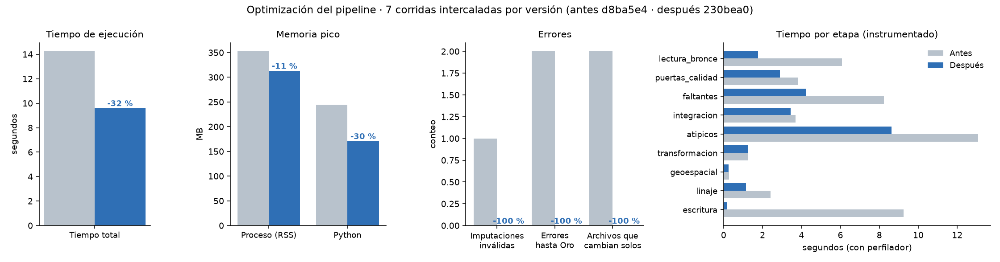

# Ficha de entrega técnica — E3

| Campo | Valor |
|---|---|
| Proyecto | Observatorio de Ocupación Hotelera de Colima (OOH-Colima) |
| Integrante | Maximiliano Encarnación Velázquez Rodríguez (`@Chonitoo`), trabajo individual |
| Repositorio | https://github.com/Chonitoo/observatorio-turismo |
| Tag | `e3` |
| Objetivo | Optimizar el pipeline con mejoras medibles y publicar el dataset curado con su ficha técnica |

## Lista de entregables

| # | Requisito | Dónde está |
|---|---|---|
| 1 | Comparativa cuantitativa antes vs. después (tiempo, memoria, errores) | [`reports/E3/comparativa.md`](../../reports/E3/comparativa.md), [`comparativa.json`](../../reports/E3/comparativa.json), figura [`docs/E3/img/comparativa.png`](img/comparativa.png) |
| 1b | Herramienta de medición reproducible | [`src/benchmark.py`](../../src/benchmark.py) |
| 2 | Dataset limpio publicado con licencia abierta (CC BY 4.0) | [`dataset/`](../../dataset): 5 tablas CSV + Parquet, diccionario, `datapackage.json`, `LICENSE.md`, `SHA256SUMS.txt` |
| 2b | Ficha técnica estandarizada (Datasheets for Datasets) | [`docs/E3/datasheet.md`](datasheet.md) |
| 3 | Ficha de entrega y relatoría | este archivo · [`docs/relatoria-E3.md`](../relatoria-E3.md) |

## 1. Optimización medida

### Metodología
- **Antes:** commit `d8ba5e4`, el pipeline tal como quedó en E2. **Después:** la versión actual.
- `python -m src.benchmark --ab d8ba5e4 --repeticiones 7` crea un *git worktree* con la versión anterior y
  **alterna** las corridas (A, B, A, B…). Así ambas versiones se miden bajo las mismas condiciones de la máquina.
  Cada corrida se hace en un **proceso nuevo**, sin caché.
- **Tiempo y memoria del proceso (RSS):** mediana de 7 corridas limpias, sin instrumentación.
- **Desglose por etapa y memoria de Python:** mediana de 3 corridas con `cProfile` + `tracemalloc`. El perfilador
  infla los valores absolutos, pero son comparables entre versiones.
- **Errores:**
  - Avisos emitidos durante la ejecución.
  - Registros inválidos que genera el propio pipeline.
  - Errores que no se detectan hasta la capa Oro.
  - Archivos que cambian al repetir la corrida **sin** datos nuevos (no determinismo → commits espurios).
- **Entorno:** Windows 11, Python 3.12.10, AMD (12 núcleos).

### Resultados



| Métrica | Antes | Después | Cambio |
|---|---:|---:|---:|
| **Tiempo total** (mediana, s) | 14.24 | 9.61 | **−32.5 %** |
| **Memoria pico del proceso** (RSS, MB) | 352.4 | 313.3 | **−11.1 %** |
| **Memoria pico de Python** (tracemalloc, MB) | 244.6 | 171.1 | **−30.0 %** |
| Avisos durante la ejecución | 0 | 0 | se mantiene |
| **Registros inválidos generados por el pipeline** | 1 | 0 | **−100 %** |
| **Errores detectados hasta la capa Oro** | 2 | 0 | **−100 %** |
| **Archivos que cambian sin datos nuevos** | 2 | 0 | **−100 %** |
| Tamaño en disco Plata + Oro (MB) | 31.9 | 31.2 | −2.1 % |

Tiempo por etapa (instrumentado): escritura **−98 %**, lectura de Bronce **−71 %**, linaje **−52 %**, faltantes
**−49 %**, atípicos **−34 %**, Puertas de Calidad **−24 %** (detalle en `reports/E3/comparativa.md`).

### Qué se optimizó y por qué

| # | Cambio | Problema detectado | Efecto |
|---|---|---|---|
| T1 | Escritura CSV con PyArrow (`src/pipeline/io_rapido.py`), con comillas mínimas | `DataFrame.to_csv` consumía ~20 % del tiempo | escritura −98 %; archivos más chicos |
| T2 | Lectura de DataTur con el motor PyArrow | convertir 7 columnas texto→número una por una | lectura de Bronce −71 % (junto con M1) |
| T3 | Clasificación de huecos **vectorizada** (rachas con sumas acumuladas) y rejilla calculada una sola vez | bucle fila por fila con `.loc` y rejilla calculada dos veces | faltantes −49 % |
| T4 | Agregación destino-mes sin `lambda` por grupo; suavizamiento con `rolling` agrupado | 6,900 llamadas Python a `sorted()` / `transform(lambda)` | menos llamadas Python por grupo |
| T5 | Isolation Forest con 100 árboles (antes 300) | ajuste de 300 árboles para un contraste secundario | atípicos −34 % |
| M1 | DENUE leído **como flujo** desde el ZIP y sólo con 14 de 42 columnas | se cargaban 22 MB descomprimidos y las 42 columnas | memoria de Python −30 %; la minimización de datos personales ocurre desde la lectura |
| M2 | Verificación del linaje contando líneas y calculando SHA-256 por bloques | `verificar()` volvía a parsear los crudos completos (55 MB) | linaje −52 % |
| M3 | Liberar intermedios grandes tras escribir Plata | copias de DataTur vivas durante todo el pipeline | menor pico de memoria |
| E1 | **Regla R6** (estadía > 30 noches) en la Puerta de entrada (*shift-left*) | 2 registros de Nuevo Nayarit (abr–may 2020, 17 llegadas y ~880 noches) sólo se detectaban al agregar en Oro | errores que llegan a Oro: 2 → 0 |
| E2 | Imputación: tasas sin interpolar usan la mediana de la serie (no 0) y **cada registro imputado se valida** antes de emitirse | una imputación creaba un registro con cuartos ocupados y cero llegadas (Ciudad Juárez 2★, may-2017) | imputaciones inválidas: 1 → 0 |
| E3 | No se imputan huecos en meses de pandemia | se interpolaba entre marzo y junio de 2020, inventando ocupación durante los cierres | 23 huecos dejan de imputarse (corrección de exactitud) |
| E4 | La cuarentena se escribe sin `fecha_proceso` | los archivos cambiaban en cada corrida y generaban commits espurios | 2 → 0 archivos no deterministas |
| E6 | Nombres de columna del DENUE normalizados a minúsculas y verificación explícita de esquema | en la validación final en GitHub Actions, el INEGI publicó la edición 11/2026 del DENUE con encabezados en MAYÚSCULAS y el pipeline se detuvo (`KeyError: 'codigo_act'`) | el pipeline acepta la nueva edición (295 establecimientos) y, si falta una columna, se detiene con un mensaje claro de "cambio de esquema" |
| E5 | Escritura **atómica** con reintentos | durante el benchmark, Windows bloqueó un archivo de salida (WinError 1224) y el pipeline se cayó | el pipeline ya no aborta ni deja archivos a medias |

### Validación de que la optimización no cambió los resultados
- Los cambios de **rendimiento** (T1–T5, M1–M3) se verificaron comparando las salidas antes y después de cada uno:
  `destino_mes.csv`, `establecimientos_hospedaje.csv` y `linaje_oro.csv` quedaron **idénticos byte por byte**.
- Los cambios de **errores** (E1–E3) sí modifican el dataset, a propósito y documentado: 2 registros más en
  cuarentena (R6), 21 imputaciones menos (pandemia), 0 imputaciones inválidas y 6,900 destino-mes en Oro (antes
  6,898, porque ya no se pierden 2 en la Puerta 3).
- Se agregaron 10 pruebas (31 en total) para R6, los huecos en pandemia, la clasificación vectorizada, la consistencia
  de las imputaciones y la publicación.

## 2. Publicación del dataset

| Archivo | Filas | Contenido |
|---|---:|---|
| `ocupacion_destino_mes.csv` | 6,900 | ocupación por destino y mes, integrada con tipo de cambio e inflación |
| `ocupacion_categoria_mes.csv` | 31,265 | ocupación por destino, categoría y mes |
| `hospedaje_establecimientos.csv` | 295 | establecimientos de hospedaje de Colima (sin datos de contacto) |
| `hospedaje_municipios.csv` | 10 | oferta de hospedaje por municipio |
| `indicadores_macro_mes.csv` | 143 | tipo de cambio FIX e inflación anual |

- **Licencia:** CC BY 4.0, con atribución a SECTUR, Banco de México e INEGI y aviso de transformación.
- **Formatos:** CSV UTF-8 (7.1 MB) y Parquet (1.3 MB).
- **Metadatos estándar:** `datapackage.json` (Frictionless Data Package) con esquema, tipos, unidades, llaves
  primarias, tamaño y huella de cada tabla. **Validado con la librería `frictionless`: 5/5 tablas válidas.**
- **Integridad:** `SHA256SUMS.txt`. Git no altera los bytes (`dataset/** -text`).
- **Privacidad:** validación automática de que ninguna columna personal llega al dataset.
- **Actualización automática:** el workflow regenera y valida el dataset después de cada captura.
- **Acceso directo:** `https://raw.githubusercontent.com/Chonitoo/observatorio-turismo/main/dataset/ocupacion_destino_mes.csv`

## Cómo reproducir

```bash
pip install -r requirements.txt
python -m src.pipeline.ejecutar                     # Bronce → Plata → Oro
python -m src.publicar                              # genera dataset/
python -m pytest -q                                 # 31 pruebas
python -m src.benchmark --ab d8ba5e4 --repeticiones 7   # comparativa A/B (≈ 5 min)
```

## Limitaciones

- Los tiempos absolutos dependen de la máquina y de su carga. Por eso la comparación es **intercalada** y con
  medianas; los porcentajes son más estables que los segundos.
- La memoria del proceso (RSS) incluye unos 182 MB (medidos) sólo por cargar las bibliotecas (pandas, GeoPandas,
  scikit-learn, Pandera, PyArrow), que no dependen del pipeline. Descontando esa base, la memoria propia del
  pipeline bajó de ≈ 170 MB a ≈ 131 MB (−23 %). Por eso la reducción en RSS total (−11 %) es menor.
- El dataset se publica en el repositorio de GitHub. Para obtener un DOI permanente se puede archivar la versión
  `e3` en Zenodo (requiere una cuenta del autor).

## Uso de herramientas de IA

Se usó un asistente de IA (Claude Code) para apoyar la programación, la medición y los borradores de la
documentación. El autor revisó las decisiones y los resultados, y es responsable del contenido.
